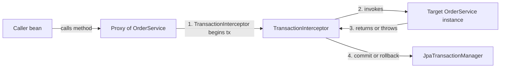
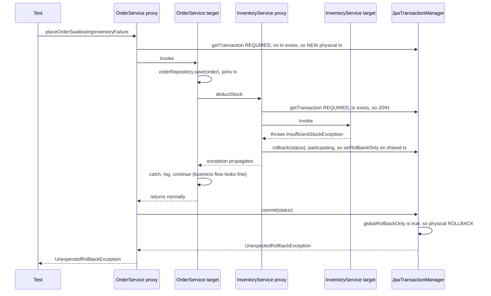
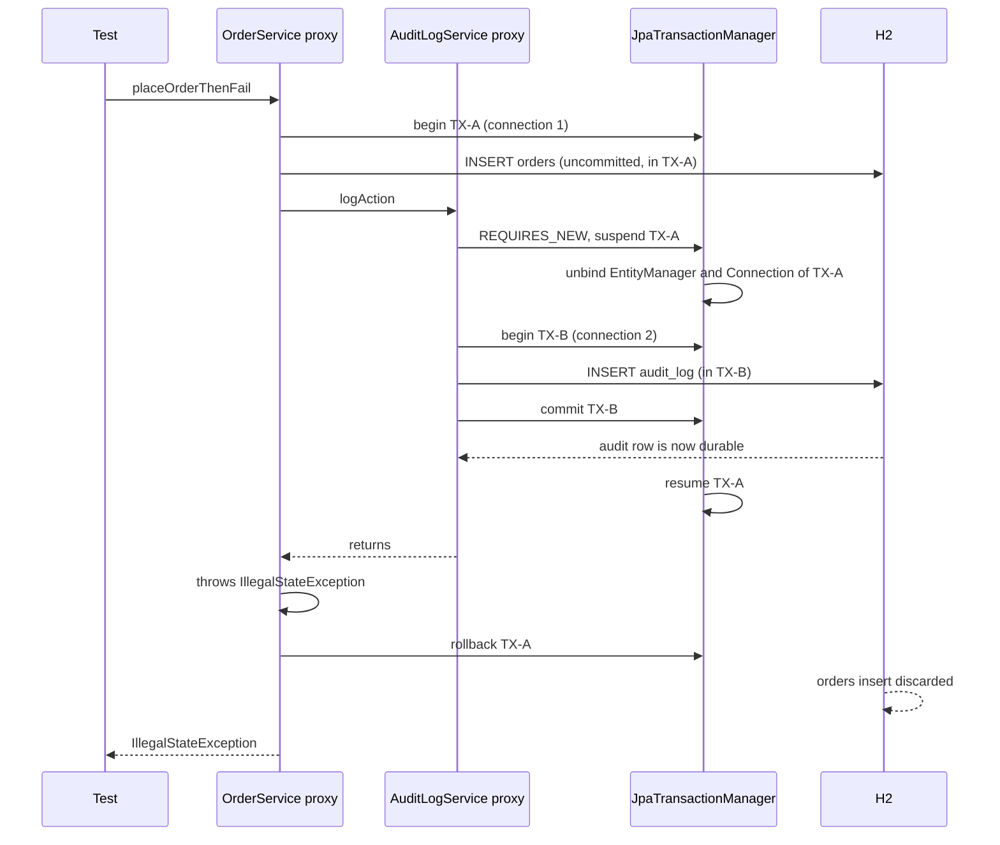
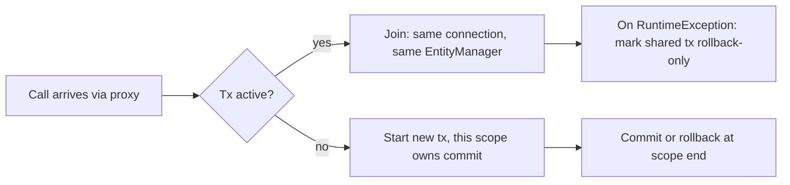
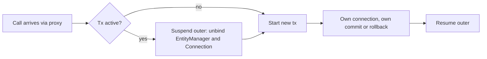

# tx-propagation-lab

A Spring Boot 3 / Spring Data JPA / H2 laboratory that **proves, with executable integration tests**, what really happens when one `@Transactional` method calls another.

Everything in this document is tied to code in this repository. Where a topic is **not** covered by a test in this repo, it is explicitly marked as *not covered by the lab* so you can tell demonstrated facts from reference knowledge.

---

## Table of Contents

1. [Quick start](#1-quick-start)
2. [Project structure](#2-project-structure)
3. [How `@Transactional` works internally](#3-how-transactional-works-internally)
4. [The evidence technique: `TxProbe`](#4-the-evidence-technique-txprobe)
5. [Scenario 1: `REQUIRED` and the rollback-only trap](#5-scenario-1-required-and-the-rollback-only-trap)
6. [Scenario 2: `REQUIRES_NEW` commits independently](#6-scenario-2-requires_new-commits-independently)
7. [Scenario 3: same-class call (self-invocation)](#7-scenario-3-same-class-call-self-invocation)
8. [Direct answer: can one `@Transactional` method call another in the same class?](#8-direct-answer-can-one-transactional-method-call-another-in-the-same-class)
9. [All the ways things go wrong, and how to avoid them](#9-all-the-ways-things-go-wrong-and-how-to-avoid-them)
10. [Is calling `@Transactional` methods across classes recommended?](#10-is-calling-transactional-methods-across-classes-recommended)
11. [Propagation reference: how each one works](#11-propagation-reference-how-each-one-works)
12. [Which propagation for which use case](#12-which-propagation-for-which-use-case)
13. [Interview questions: tricky scenarios with detailed answers](#13-interview-questions-tricky-scenarios-with-detailed-answers)
14. [Test inventory](#14-test-inventory)
15. [Debugging checklist](#15-debugging-checklist)
16. [Code review checklist](#16-code-review-checklist)
17. [Extending the lab](#17-extending-the-lab)

---

## 1. Quick start

Requirements: Java 17+, Maven 3.8+.

```bash
mvn clean test
```

To watch transaction boundaries, read the console. `application.properties` enables:

```properties
logging.level.org.springframework.transaction.interceptor=TRACE
logging.level.org.springframework.orm.jpa.JpaTransactionManager=DEBUG
```

You will see lines such as `Getting transaction for [...]`, `Participating in existing transaction`, `Suspending current transaction, creating new transaction`, `Participating transaction failed - marking existing transaction as rollback-only`, and `Initiating transaction rollback`.

---

## 2. Project structure

```
src/main/java/com/example/tx
├── TxPropagationLabApplication.java
├── entity
│   ├── OrderEntity.java          table: orders      (sku, quantity, status)
│   ├── InventoryEntity.java      table: inventory   (sku unique, quantity)
│   └── AuditLogEntity.java       table: audit_log   (action, createdAt)
├── repository
│   ├── OrderRepository.java
│   ├── InventoryRepository.java  findBySku(...)
│   └── AuditLogRepository.java   findByAction(...)
├── service
│   ├── OrderService.java         Scenario 1 and 2 entry points (outer transactions)
│   ├── InventoryService.java     REQUIRED and REQUIRES_NEW variants of deductStock
│   ├── AuditLogService.java      REQUIRES_NEW audit writer
│   ├── PaymentService.java       Scenario 3: self-invocation bug and both fixes
│   ├── DiscountService.java      Fix #1: extracted REQUIRES_NEW bean
│   └── InsufficientStockException.java   unchecked (RuntimeException)
└── support
    └── TxProbe.java              records isActualTransactionActive() and transaction name

src/test/java/com/example/tx
└── NestedTransactionalIT.java    7 integration tests, deliberately NOT @Transactional
```

### Method map

| Class | Method | Propagation | Role |
|---|---|---|---|
| `OrderService` | `placeOrderSwallowingInventoryFailure` | REQUIRED | Scenario 1: the try-catch trap |
| `OrderService` | `placeOrderPropagatingInventoryFailure` | REQUIRED | Scenario 1 baseline: no catch |
| `OrderService` | `placeOrderWithIsolatedInventory` | REQUIRED | Scenario 1 fix: inner call is `REQUIRES_NEW` |
| `OrderService` | `placeOrderThenFail` | REQUIRED | Scenario 2: parent fails after audit |
| `InventoryService` | `deductStock` | REQUIRED | joins the caller's transaction |
| `InventoryService` | `deductStockRequiresNew` | REQUIRES_NEW | own transaction |
| `AuditLogService` | `logAction` | REQUIRES_NEW | own transaction, commits immediately |
| `PaymentService` | `processPayment` | REQUIRED | Scenario 3: calls `this.applyDiscount` (bug) |
| `PaymentService` | `applyDiscount` | REQUIRES_NEW | silently ignored when called via `this` |
| `PaymentService` | `processPaymentSplitBean` | REQUIRED | Fix #1: calls `DiscountService` |
| `PaymentService` | `processPaymentSelfInjected` | REQUIRED | Fix #2: calls `self.applyDiscount` |
| `DiscountService` | `applyDiscount` | REQUIRES_NEW | the extracted bean |

---

## 3. How `@Transactional` works internally

`@Transactional` is **not magic inside your method**. It is an AOP feature. Understanding the five moving parts explains every scenario in this lab.

### 3.1 The proxy

At startup, Spring detects beans that have `@Transactional` and wraps each one in a **proxy** (CGLIB subclass in Spring Boot by default, since `spring.aop.proxy-target-class=true`). The object injected into your other beans is the **proxy**, not your raw class.



### 3.2 The interceptor decision

For every call that arrives **through the proxy**, `TransactionInterceptor`:

1. Reads the `@Transactional` attributes (propagation, isolation, readOnly, timeout, rollback rules).
2. Asks the `PlatformTransactionManager` (`JpaTransactionManager` here) for a transaction according to the propagation rules: create new, join existing, suspend and create new, and so on.
3. Invokes your method.
4. On normal return: commits if this call **created** the transaction. If it merely joined one, it does nothing.
5. On exception: applies the rollback rules, then either rolls back (if it owns the transaction) or marks the shared transaction **rollback-only** (if it joined).

### 3.3 Thread-bound state

The "current transaction" lives in `ThreadLocal` storage inside `TransactionSynchronizationManager`: the `EntityManager` holder, the JDBC `Connection` holder, the transaction name, and the "actual transaction active" flag. That is why:

* A different thread (`@Async`, parallel stream, executor) has **no** transaction.
* `REQUIRES_NEW` must **unbind** those resources, bind new ones (a second `EntityManager` and a **second physical connection**), and restore the originals afterwards.

### 3.4 Physical vs logical transactions

* **Physical transaction**: one real database transaction on one connection.
* **Logical transaction scope**: each `@Transactional` method invocation is a logical scope.

With `REQUIRED`, many logical scopes map to **one** physical transaction. Only the **outermost** scope may commit. Inner scopes can only veto, by marking the whole physical transaction rollback-only. This single sentence is the root cause of Scenario 1.

### 3.5 Default rollback rules

| Thrown | Default behavior |
|---|---|
| `RuntimeException` (unchecked) | rollback |
| `Error` | rollback |
| Checked `Exception` | **commit** (!) unless `rollbackFor` is set |

---

## 4. The evidence technique: `TxProbe`

Asserting on row counts alone shows *what* happened, not *why*. `TxProbe` captures, at the start of each service method:

* `TransactionSynchronizationManager.isActualTransactionActive()`
* `TransactionSynchronizationManager.getCurrentTransactionName()`

The transaction name is the fully qualified name of the method that **started** the physical transaction, for example `com.example.tx.service.OrderService.placeOrderSwallowingInventoryFailure`. This gives a reliable rule:

> If an inner method reports the **same transaction name** as the outer method, it ran inside the **same physical transaction**.
> If it reports **its own** name, it got a **new** physical transaction.

| Scenario | Outer name | Inner name | Conclusion |
|---|---|---|---|
| 1 `REQUIRED` | `OrderService.placeOrderSwallowing...` | same as outer | shared transaction |
| 1 fix `REQUIRES_NEW` | `OrderService.placeOrderWithIsolatedInventory` | `InventoryService.deductStockRequiresNew` | separate transactions |
| 2 `REQUIRES_NEW` | `OrderService.placeOrderThenFail` | `AuditLogService.logAction` | separate transactions |
| 3 self-invocation | `PaymentService.processPayment` | **same as outer** | proxy bypassed |
| 3 fix (split bean) | `PaymentService.processPaymentSplitBean` | `DiscountService.applyDiscount` | separate transactions |
| 3 fix (self-injection) | `PaymentService.processPaymentSelfInjected` | `PaymentService.applyDiscount` | separate transactions |

---

## 5. Scenario 1: `REQUIRED` and the rollback-only trap

### Code

```java
@Service
public class OrderService {

    @Transactional
    public OrderEntity placeOrderSwallowingInventoryFailure(String sku, int quantity) {
        OrderEntity order = orderRepository.save(new OrderEntity(sku, quantity, "CREATED"));
        try {
            inventoryService.deductStock(sku, quantity);      // REQUIRED: joins our tx
        } catch (RuntimeException ex) {
            // looks handled...
        }
        return order;                                          // commit attempted here
    }
}

@Service
public class InventoryService {

    @Transactional                                             // default = REQUIRED
    public void deductStock(String sku, int quantity) {
        // throws InsufficientStockException when stock is too low
    }
}
```

### Workflow



### Step-by-step

1. The outer proxy opens a **new** physical transaction and the order row is inserted.
2. `deductStock` is called via the injected `InventoryService` proxy. With `REQUIRED` it **joins** the existing transaction. No new connection is used.
3. `InsufficientStockException` is a `RuntimeException`, so the inner interceptor decides "rollback". But the inner scope does not own the transaction, so it cannot roll back for real. Instead `AbstractPlatformTransactionManager` calls `doSetRollbackOnly` on the shared transaction (this behavior is governed by `globalRollbackOnParticipationFailure`, default `true`).
4. `OrderService` catches the exception. Java-wise the exception is handled. Transaction-wise the damage is permanent: the flag cannot be cleared.
5. The outer method returns normally, so the outer interceptor tries to commit. It finds the rollback-only flag, performs a physical rollback, and throws `UnexpectedRollbackException` ("Transaction silently rolled back because it has been marked as rollback-only").

### What the test proves

```java
@Test
void testRequired_WithExceptionHandled_ThrowsUnexpectedRollbackException() {
    assertThatThrownBy(() -> orderService.placeOrderSwallowingInventoryFailure(SKU, 5))
            .isInstanceOf(UnexpectedRollbackException.class)
            .hasMessageContaining("rollback-only");
    assertThat(orderRepository.count()).isZero();   // order insert rolled back
    // inner.transactionName() == outer.transactionName()  -> same physical tx
}
```

### Companion tests

| Test | What it shows |
|---|---|
| `testRequired_WithoutCatch_PropagatesOriginalExceptionAndRollsBack` | Without the catch, the caller sees the **original** `InsufficientStockException`, not `UnexpectedRollbackException`. The data outcome is identical (rolled back), but the error is honest. |
| `testRequiresNew_OnRiskyCall_AllowsParentToCatchAndCommit` | When the risky call uses `REQUIRES_NEW` (`deductStockRequiresNew`), only the inner transaction rolls back. The outer one is clean, catches the exception, sets status to `BACKORDERED`, and commits. |

### How to avoid the trap

| Option | When to use | Trade-off |
|---|---|---|
| **Do not catch**; let it propagate | The failure should abort the whole use case (most cases) | None. Simplest and safest. |
| **`REQUIRES_NEW`** on the risky inner call (this lab's fix) | The failure is genuinely recoverable and the outer work must still commit | Extra connection, inner commit is permanent even if outer later rolls back |
| **`NESTED`** (savepoint) | Same as above, but you want inner work to be undone if the outer later fails | Needs savepoint support; Hibernate session state caveat (see section 11) |
| **Check first, then act** (query stock before deducting) | Failure is predictable | Race conditions unless combined with locking |
| **`noRollbackFor`** on the inner method | The exception is a business signal, not a failure | Any data the inner method changed **before** throwing will be committed |
| **`TransactionTemplate`** around the risky block | You need fine-grained programmatic control | More verbose |

---

## 6. Scenario 2: `REQUIRES_NEW` commits independently

### Code

```java
@Transactional
public void placeOrderThenFail(String sku, int quantity) {
    orderRepository.save(new OrderEntity(sku, quantity, "CREATED"));
    auditLogService.logAction("ORDER_CREATED");     // REQUIRES_NEW
    throw new IllegalStateException("Simulated failure after audit log was written");
}

@Transactional(propagation = Propagation.REQUIRES_NEW)
public void logAction(String action) {
    auditLogRepository.save(new AuditLogEntity(action));
}
```

### Workflow



### Result asserted by the test

```java
assertThat(orderRepository.count()).isZero();                              // parent rolled back
assertThat(auditLogRepository.findByAction("ORDER_CREATED")).hasSize(1);   // audit survived
```

### Why this matters in production

* **Audit trails and security logs** must survive business failures.
* **Failure counters / retry bookkeeping** must be recorded even when the main work rolls back.
* But note the **cost**: a second physical connection is held while the first is still open. See interview question 9 (connection-pool deadlock).

---

## 7. Scenario 3: same-class call (self-invocation)

### The bug

```java
@Service
public class PaymentService {

    @Transactional
    public void processPayment(Long orderId) {
        this.applyDiscount(orderId);   // <-- goes directly to the target object
        throw new IllegalStateException("Payment gateway failed after discount");
    }

    @Transactional(propagation = Propagation.REQUIRES_NEW)
    public void applyDiscount(Long orderId) {
        auditLogRepository.save(new AuditLogEntity("DISCOUNT_APPLIED:" + orderId));
    }
}
```

### Why the annotation is ignored

```mermaid
flowchart TB
    subgraph External call enters through the proxy
        Caller1[Test or controller] --> Proxy1[PaymentService PROXY]
        Proxy1 -->|interceptor opens TX| Target1[PaymentService TARGET processPayment]
    end
    subgraph Inside the target
        Target1 -->|"this.applyDiscount(...)"| Target1b[PaymentService TARGET applyDiscount]
    end
    Proxy1 -.->|never involved in the inner call| Target1b
```

`this` inside `processPayment` is the **raw target object**, not the proxy. A direct Java method call does not pass through any interceptor, so `TransactionInterceptor` never sees `applyDiscount`, never evaluates `REQUIRES_NEW`, never suspends the outer transaction. The annotation is not "wrong"; it is simply **never read** for that call.

### Proof from the test

```java
@Test
void testSelfInvocation_BypassesProxy() {
    assertThat(AopUtils.isAopProxy(paymentService)).isTrue();       // the bean IS proxied

    assertThatThrownBy(() -> paymentService.processPayment(42L))
            .isInstanceOf(IllegalStateException.class);

    // inner reports the OUTER transaction's name: no new transaction was created
    assertThat(inner.transactionName()).isEqualTo(outer.transactionName());

    // so the discount row was rolled back together with everything else
    assertThat(auditLogRepository.findByAction("DISCOUNT_APPLIED:42")).isEmpty();
}
```

If the proxy had been honored, `DISCOUNT_APPLIED:42` would have been **committed** (1 row), exactly as in the two fixed tests below.

### Fix #1 (preferred): move the method to another bean

```java
@Service
public class DiscountService {
    @Transactional(propagation = Propagation.REQUIRES_NEW)
    public void applyDiscount(Long orderId) { ... }
}

// in PaymentService
@Transactional
public void processPaymentSplitBean(Long orderId) {
    discountService.applyDiscount(orderId);   // goes through DiscountService's proxy
    throw new IllegalStateException(...);
}
```

Test: `testSelfInvocationFix_SplitBean_HonorsRequiresNew` asserts the names differ and the discount row **survives** (1 row).

### Fix #2: self-injection

```java
public PaymentService(AuditLogRepository repo, DiscountService discountService,
                      TxProbe probe, @Lazy PaymentService self) {
    ...
    this.self = self;               // injected value is the PROXY
}

@Transactional
public void processPaymentSelfInjected(Long orderId) {
    self.applyDiscount(orderId);    // goes through this bean's own proxy
    throw new IllegalStateException(...);
}
```

`@Lazy` is mandatory: Spring Boot disallows circular references by default, and a bean depending on itself is circular. `@Lazy` injects a lazy-resolving proxy instead.

Test: `testSelfInvocationFix_SelfInjection_HonorsRequiresNew`.

### Other fixes (not covered by the lab)

| Fix | Notes |
|---|---|
| `AopContext.currentProxy()` | Requires `@EnableAspectJAutoProxy(exposeProxy = true)`. Couples business code to Spring AOP internals. Avoid. |
| AspectJ weaving mode (`@EnableTransactionManagement(mode = AdviceMode.ASPECTJ)`) | Transactional behavior is woven into bytecode, so `this.` calls work. Needs a weaver; heavier build. |
| `TransactionTemplate` with `PROPAGATION_REQUIRES_NEW` inside the method | No proxy needed. Good for small, local needs. |
| Restructure so only one level is transactional | Often the cleanest: ask whether the inner call needs its own transaction at all. |

---

## 8. Direct answer: can one `@Transactional` method call another in the same class?

**Short answer: it does not throw an error by itself, but the second annotation is silently ignored, which can produce wrong data without any exception.**

| How the second method is invoked | Is the inner `@Transactional` honored? | Result |
|---|---|---|
| `this.inner()` or plain `inner()` from inside the same class | **No.** Proxy bypassed. | Inner runs inside the caller's transaction (or with no transaction at all if the caller is not transactional) |
| `self.inner()` where `self` is the injected proxy | Yes | Propagation rules apply normally |
| Inner method moved to another Spring bean | Yes | Propagation rules apply normally |
| Two methods in the same class, each called **externally** (e.g. controller calls A, then B) | Yes, each separately | Two independent transactions |

### The errors and surprises you can get from same-class calls

| Situation | Outcome | Why |
|---|---|---|
| Inner is `REQUIRES_NEW`, called via `this` | **No new transaction.** Work you expected to commit independently is rolled back with the parent (Scenario 3). | Proxy bypass |
| Outer has **no** `@Transactional`, inner has `@Transactional`, called via `this` | **No transaction at all.** Writes may run in auto-commit or fail with `TransactionRequiredException` ("No EntityManager with actual transaction available"). | Proxy bypass |
| Inner is `MANDATORY`, outer not transactional, called via `this` | The `IllegalTransactionStateException` you *expected* never appears. The code just runs without a transaction. | Proxy bypass: the check is never made |
| Inner is `readOnly = true`, outer is read-write, via `this` | Inner's `readOnly` has no effect | Proxy bypass |
| Inner has a different `isolation` or `timeout`, via `this` | Ignored | Proxy bypass |
| Inner is `private` | Ignored even from an external proxy call | Proxy cannot intercept private methods |
| Inner is `final` (or class is `final`) with CGLIB | Not intercepted; class cannot even be proxied if final | CGLIB subclasses cannot override final members |

So: calling is **allowed**, but you must never *rely* on the inner annotation unless the call crosses the proxy boundary.

---

## 9. All the ways things go wrong, and how to avoid them

A consolidated catalogue. Items marked **(lab)** are proven by a test in this repo.

### 9.1 Proxy-related

| # | Pitfall | Symptom | Avoidance |
|---|---|---|---|
| 1 | **Self-invocation (lab)** | Inner `@Transactional` ignored | Split bean / self-injection / `TransactionTemplate` |
| 2 | `private` method annotated | Silently ignored | Use `public` (protected and package-private only work with class-based proxies in Spring 6+, and are discouraged) |
| 3 | `final` method or class (CGLIB) | Not advised, or startup failure | Remove `final`; Kotlin needs the `allopen` plugin |
| 4 | Object created with `new` | No proxy, no transaction | Let Spring create and inject it |
| 5 | Annotation on interface with class-based proxies | May be ignored depending on config | Annotate the **class** |
| 6 | Calling from `@PostConstruct` / constructor | Proxy not fully ready, no transaction | Use `ApplicationReadyEvent`, `SmartInitializingSingleton`, or `TransactionTemplate` |

### 9.2 Rollback-related

| # | Pitfall | Symptom | Avoidance |
|---|---|---|---|
| 7 | **Rollback-only trap (lab)** | `UnexpectedRollbackException` on outer commit | Do not swallow; or use `REQUIRES_NEW` / `NESTED` for recoverable inner work |
| 8 | **Checked exception commits** | `throws Exception` leads to **commit** of partial data | `@Transactional(rollbackFor = Exception.class)` or throw unchecked |
| 9 | Catching the exception and not rethrowing in the **same** transactional method | Transaction commits normally; data inconsistency | Rethrow, or call `TransactionAspectSupport.currentTransactionStatus().setRollbackOnly()` explicitly |
| 10 | `noRollbackFor` on inner + partial writes | Half-done inner work is committed | Only use for exceptions that are pure signals |
| 11 | Exception thrown inside `@TransactionalEventListener(AFTER_COMMIT)` | Original transaction already committed; error does not undo it | Treat as separate failure handling |

### 9.3 Propagation and attribute-related

| # | Pitfall | Symptom | Avoidance |
|---|---|---|---|
| 12 | Inner `readOnly = true` joins outer read-write | `readOnly` ignored | Use `REQUIRES_NEW` if you truly need a different mode |
| 13 | Outer `readOnly = true`, inner `REQUIRED` writes | Inner joins the read-only transaction; Hibernate flush mode is `MANUAL` so **writes may silently not be flushed** | Do not write under a read-only transaction |
| 14 | Inner declares different `isolation` or `timeout` while joining | Silently ignored | Set `validateExistingTransaction=true` on the transaction manager to fail fast |
| 15 | `MANDATORY` called with no transaction | `IllegalTransactionStateException` (this is intended: it is a guard) | Ensure callers are transactional |
| 16 | `NEVER` called inside a transaction | `IllegalTransactionStateException` | Intended guard |

### 9.4 Resource and concurrency

| # | Pitfall | Symptom | Avoidance |
|---|---|---|---|
| 17 | **Connection pool deadlock with `REQUIRES_NEW`** | Threads hang waiting for a connection | Pool size must exceed (concurrent requests x nesting depth); keep `REQUIRES_NEW` rare |
| 18 | **Outer and inner `REQUIRES_NEW` touch the same row** | Inner blocks on a lock held by the suspended outer, until lock timeout (self-deadlock) | Never let a `REQUIRES_NEW` method write rows the outer transaction already modified |
| 19 | `@Async` or new thread | No transaction on the new thread | Put `@Transactional` on the async method itself (via proxy) |
| 20 | Parallel streams / executors inside a transaction | Worker threads have no transaction | Collect results first, write in the transactional thread |
| 21 | Long transactions with remote calls (HTTP, messaging) inside | Locks held, pool starvation, timeouts | Keep transactions short; call remote systems outside |

### 9.5 JPA / persistence context

| # | Pitfall | Symptom | Avoidance |
|---|---|---|---|
| 22 | `LazyInitializationException` | Lazy association accessed after the transaction ended (this lab sets `open-in-view=false`, which makes this visible) | Fetch what you need inside the transaction (DTO projection, `JOIN FETCH`) |
| 23 | Hibernate `NESTED` savepoint rollback | Entities loaded or changed in the rolled-back section remain in the persistence context | Clear/refresh affected entities, or avoid `NESTED` with JPA |
| 24 | Transactional test hides real behavior | `@Transactional` on a test wraps everything in one transaction, so `REQUIRES_NEW` and commit behavior are distorted | Keep propagation tests **non**-transactional (as `NestedTransactionalIT` does) |

---

## 10. Is calling `@Transactional` methods across classes recommended?

**Yes. Calling across beans is the recommended and supported design.** Every call crosses a proxy, so propagation, rollback rules and attributes are all honored. That is also why the fixes in Scenario 3 are all "make the call cross a proxy".

### Guidelines

1. **Put the transaction boundary on the use-case (application service) method**, e.g. `OrderService.placeOrder...`. One user action equals one transaction.
2. **Let collaborators join** with the default `REQUIRED`. `InventoryService.deductStock` should usually just participate.
3. **Repositories are already transactional.** `SimpleJpaRepository` is annotated with `@Transactional(readOnly = true)` at class level, and write methods such as `save` / `deleteAll` override it with `REQUIRED`. They join your service transaction automatically.
4. **Use a different propagation only with a clear reason** (audit, independent retry bookkeeping, a guard). Document that reason in a comment.
5. **Do not annotate every method reflexively.** Annotating tiny helpers adds nothing (they join anyway) and hides where the real boundary is.
6. **Avoid long call chains of `REQUIRES_NEW`.** Each level takes another connection.
7. **Avoid controllers owning transactions.** Keep them in the service layer so the web layer stays thin and tests are simpler.
8. **Design for failure semantics up front.** Decide: if the inner call fails, should the whole use case fail? If yes, propagate. If no, isolate it (`REQUIRES_NEW` or `NESTED`) *deliberately*.

### Good vs bad shape

```
GOOD                                          BAD
Controller (no tx)                            Controller @Transactional
  └─ OrderService @Transactional  <-- boundary  └─ OrderService @Transactional(REQUIRES_NEW)
       ├─ InventoryService (REQUIRED joins)          └─ InventoryService @Transactional(REQUIRES_NEW)
       ├─ PaymentService   (REQUIRED joins)               └─ ... three connections per request
       └─ AuditLogService  (REQUIRES_NEW, deliberate)
```

---

## 11. Propagation reference: how each one works

`Propagation` answers one question: **"What should happen if a transaction already exists (or does not) when this method is called through a proxy?"**

### Summary table

| Propagation | Tx exists | No tx exists | Physical transactions | Typical use |
|---|---|---|---|---|
| `REQUIRED` (default) | **Join** it | Create new | 1 shared | Almost everything |
| `REQUIRES_NEW` | **Suspend** it, create new | Create new | 2 independent | Audit, independent bookkeeping |
| `NESTED` | Create **savepoint** inside it | Create new (behaves like REQUIRED) | 1, with savepoints | Optional sub-step that may fail without killing the whole unit |
| `SUPPORTS` | Join it | Run **without** tx | 0 or 1 | Read helpers that work either way |
| `NOT_SUPPORTED` | **Suspend** it, run without tx | Run without tx | 0 | Long non-transactional work (reports, calls to slow systems) |
| `MANDATORY` | Join it | **Throw** `IllegalTransactionStateException` | 1 | Guard: "must be called inside a use-case transaction" |
| `NEVER` | **Throw** `IllegalTransactionStateException` | Run without tx | 0 | Guard: "must never run inside a transaction" |

### 11.1 `REQUIRED`



* Only the **outermost** scope commits or rolls back for real.
* Inner failure poisons the whole transaction (Scenario 1).
* `readOnly`, `isolation`, `timeout` of the inner are ignored when joining.

### 11.2 `REQUIRES_NEW`



* Inner commits **before** the outer finishes. If the outer later rolls back, the inner is **not** undone (Scenario 2).
* If the inner fails and the exception is caught outside the inner proxy, the outer is **not** poisoned (Scenario 1 companion test).
* Costs a second connection and has the self-deadlock/pool risks in section 9.4.

### 11.3 `NESTED` *(not covered by the lab's tests)*

* Creates a JDBC **savepoint** in the existing physical transaction.
* Inner failure rolls back **to the savepoint**; the outer may catch and continue and still commit its own work.
* If the outer rolls back, the inner work is rolled back too (unlike `REQUIRES_NEW`).
* Needs savepoint support (JDBC `DataSource`/JPA with `JpaTransactionManager` works; JTA does not).
* **Hibernate caveat:** Hibernate's persistence context is not rewound to the savepoint. Entities touched in the nested section may still look "modified" in memory. Clear or re-read them.

```java
@Transactional(propagation = Propagation.NESTED)
public void tryOptionalStep() { ... }
```

### 11.4 `SUPPORTS`

* Uses a transaction if the caller has one, otherwise runs **non-transactionally**.
* Subtle: even "without a transaction", Spring still creates an empty *transaction synchronization scope* (so a shared `EntityManager` is reused within it), but **no** database transaction is opened.
* Rarely the right choice. Prefer `REQUIRED` + `readOnly = true` for reads.

### 11.5 `NOT_SUPPORTED`

* Suspends any current transaction and runs without one. Resumes afterwards.
* Useful for long, slow, read-only external work you do not want to hold locks for (for example, generating a file or calling a remote service from inside a transactional use case).

### 11.6 `MANDATORY`

* **Fail-fast guard.** Throws `IllegalTransactionStateException` ("No existing transaction found for transaction marked with propagation 'mandatory'") if called without a transaction.
* Excellent for methods that must never be the transaction boundary (for example, low-level domain operations that assume the caller owns consistency).

### 11.7 `NEVER`

* Throws `IllegalTransactionStateException` if a transaction **is** active.
* Guard for operations that must not run inside a transaction (for example, certain DDL, or calls that must not hold locks).

---

## 12. Which propagation for which use case

| Need | Recommended | Why |
|---|---|---|
| Normal business use case spanning several services | `REQUIRED` everywhere | One atomic unit, simplest semantics |
| Audit log / security event that must persist even if the business transaction fails | `REQUIRES_NEW` (`AuditLogService.logAction`) | Independent commit |
| Recording a failed attempt / retry counter / outbox of failures | `REQUIRES_NEW` | Must survive the rollback of the failing work |
| Optional enrichment where failure should not kill the main flow **and** its data should also vanish if the main flow rolls back | `NESTED` | Savepoint rollback; commits with the parent |
| Optional step where failure should not kill the main flow and its data should **persist regardless** | `REQUIRES_NEW` | Commits on its own |
| Domain method that must only ever run inside a use case | `MANDATORY` | Fail-fast guard |
| Operation that must never hold a transaction (long I/O, DDL) | `NEVER` or `NOT_SUPPORTED` | Avoid long locks |
| Slow report or remote call inside a transactional workflow | `NOT_SUPPORTED` (or move outside the transaction) | Do not hold locks while waiting |
| Pure read query | `REQUIRED` + `readOnly = true` (at the boundary) | Hints and flush-mode optimizations |
| Code that works with or without a transaction | `SUPPORTS` (rare) | Flexible helper |

### Rules of thumb

1. **Default to `REQUIRED`.** Add something else only with a written reason.
2. **`REQUIRES_NEW` is for "this must commit regardless of what happens to the caller".** If you cannot finish that sentence, you probably do not need it.
3. **Prefer propagation over catch-and-continue.** If a failure should abort the use case, let the exception travel.
4. **Make guard rails explicit.** `MANDATORY` documents and enforces an architectural rule at runtime.
5. **Never use `REQUIRES_NEW` to "fix" an `UnexpectedRollbackException` without understanding why the inner failed.** You may be committing a half-finished state.

---

## 13. Interview questions: tricky scenarios with detailed answers

Each answer points to the code in this lab where relevant.

### Q1. Method A (`@Transactional`) calls method B (`@Transactional(REQUIRES_NEW)`) in the same class. How many transactions are created?

**One.** `this.B()` bypasses the proxy, so B's annotation is never evaluated. B runs inside A's transaction. In this lab: `PaymentService.processPayment` / `applyDiscount`, proven by `testSelfInvocation_BypassesProxy` (same transaction name, discount row rolled back). If A is not transactional either, B runs with **no** transaction.

### Q2. How do you fix self-invocation? Which fix do you prefer?

(1) Move B to another bean (`DiscountService`), (2) self-inject the proxy with `@Lazy` (`processPaymentSelfInjected`), (3) `AopContext.currentProxy()`, (4) AspectJ weaving, (5) `TransactionTemplate`. **Prefer (1)**: it is the cleanest design and also forces you to think about responsibilities. Self-injection works but looks odd and hides a design smell.

### Q3. Inner `@Transactional` method throws a `RuntimeException`, the outer method catches it and returns normally. Does the outer transaction commit?

**No.** With `REQUIRED`, the inner scope marked the shared transaction rollback-only. The outer commit attempt performs a rollback and throws `UnexpectedRollbackException`. This is `testRequired_WithExceptionHandled_ThrowsUnexpectedRollbackException`.

### Q4. Same as Q3, but the inner method is `REQUIRES_NEW`. What happens?

The inner transaction rolls back by itself; the outer is untouched. The outer catches the exception and commits normally. See `testRequiresNew_OnRiskyCall_AllowsParentToCatchAndCommit` (order saved with status `BACKORDERED`, inventory unchanged).

### Q5. Inner is `REQUIRES_NEW` and **succeeds**; outer then throws. What is persisted?

Inner's data is **persisted**; outer's data is **rolled back**. `testRequiresNew_CommitsIndependently_WhenParentRollsBack`: 0 orders, 1 audit row.

### Q6. Can you "un-poison" a rollback-only transaction?

No. Once a transaction is marked rollback-only it can never commit. You can only let it roll back (and report accurately), or avoid the poisoning in the first place (`REQUIRES_NEW`, `NESTED`, `noRollbackFor`, check-before-act).

### Q7. Does a checked exception roll back?

By default **no**: Spring rolls back on `RuntimeException` and `Error` only. `throws IOException` out of a `@Transactional` method **commits**. Use `rollbackFor = Exception.class`. This is why `InsufficientStockException` in this lab extends `RuntimeException` ("unchecked on purpose").

### Q8. Does `readOnly = true` on the inner method make the inner method read-only inside a read-write outer transaction?

No. When joining, the inner's `readOnly`, `isolation` and `timeout` are ignored. To catch mismatches, set `validateExistingTransaction=true` on the transaction manager. Conversely, if the **outer** is `readOnly = true` and the inner (`REQUIRED`) writes, the inner joins a read-only transaction and, with Hibernate, flush mode is `MANUAL`, so the writes may silently never be flushed.

### Q9. Why can `REQUIRES_NEW` deadlock an application?

Each `REQUIRES_NEW` holds the outer connection **and** takes another. With a pool of size N and N concurrent requests, every thread can hold one connection while waiting for a second, and nobody can proceed: **pool starvation deadlock**. Avoid by keeping `REQUIRES_NEW` rare, sizing the pool above (threads x depth), and setting a connection acquisition timeout.

### Q10. Outer updates row X, then calls a `REQUIRES_NEW` method that updates row X. What happens?

The inner transaction needs a lock the suspended outer transaction still holds, while the outer is waiting for the inner. Result: **self-deadlock** until the database lock timeout. (Not covered by the lab's tests; in this lab the outer and inner touch different tables, by design.)

### Q11. Why is `testSelfInvocation_BypassesProxy` asserting `AopUtils.isAopProxy(paymentService)`?

To prove the bean **is** proxied. The bypass is not caused by a missing proxy; it is caused by the call not going through it. This distinction is the heart of the question.

### Q12. Why are the integration tests not annotated with `@Transactional`?

A test-managed transaction would wrap every call: outer methods would join the *test's* transaction (`REQUIRED`), the final commit would never happen (it rolls back at test end), and `UnexpectedRollbackException` would not appear at the same place. The tests assert real commit and rollback outcomes, so they must run outside any ambient transaction.

### Q13. What does `TransactionSynchronizationManager.isActualTransactionActive()` return for `SUPPORTS` with no existing transaction?

`false`. A synchronization scope may exist, but no actual database transaction. That is why the lab logs `isActualTransactionActive()` rather than just `isSynchronizationActive()`.

### Q14. A `@Transactional` method is `private`. Does it work?

No. Proxies cannot intercept private methods; the annotation is silently ignored. (In Spring 6+, protected and package-visible methods can work with class-based proxies, but `public` is the convention and the safest choice.)

### Q15. `@Transactional` on a method called from `@PostConstruct`?

Not reliable: the proxy is not applied until initialization completes, so there is no transaction. Use `ApplicationReadyEvent`, `SmartInitializingSingleton`, or a `TransactionTemplate`.

### Q16. A transactional method starts a thread / uses `@Async`. Is the work in the thread transactional?

No. Transaction state is `ThreadLocal`. The new thread has no transaction. Put `@Transactional` on the `@Async` method (called through its proxy), and understand it becomes a **separate** transaction.

### Q17. What happens if I write to the database inside `@TransactionalEventListener(phase = AFTER_COMMIT)`?

The original transaction has already committed, and the transaction resources may still be bound, so a plain `REQUIRED` write may never be committed. Use `@Transactional(propagation = REQUIRES_NEW)` on the listener if it needs to write.

### Q18. What does `NESTED` give you that `REQUIRES_NEW` does not?

Atomicity with the parent: if the parent later rolls back, nested work rolls back as well, while an inner failure can still be recovered without poisoning the parent. `REQUIRES_NEW` commits independently and cannot be undone by the parent. Trade-off: `NESTED` needs savepoint support and has the Hibernate persistence-context caveat.

### Q19. Which is safer to put on class level vs method level?

Method-level annotations override class-level ones. Class-level `@Transactional` gives every public method a transaction (handy, but it can hide where the boundary really is and apply write transactions to read paths). A common convention: class-level `@Transactional(readOnly = true)` for query services and method-level `@Transactional` on write methods.

### Q20. The outer catches the exception and calls `setRollbackOnly()` explicitly. Why would you do that?

To get **explicit** rollback semantics without rethrowing: `TransactionAspectSupport.currentTransactionStatus().setRollbackOnly()`. The commit then performs a *planned* rollback; because the flag was set locally by the outermost scope, it does not raise `UnexpectedRollbackException`. Useful when you want to return an error response rather than throw.

### Q21. Inner method is `@Transactional(noRollbackFor = InsufficientStockException.class)`. Does Scenario 1 still fail?

No. The inner interceptor does not mark rollback-only for that exception, so the outer catch works and the outer commits. **Caution:** anything the inner method wrote before throwing is committed with the outer. Only use it when the exception is a clean signal raised before partial writes.

### Q22. Why does `repository.save()` not need `@Transactional` on my service to "work"?

`SimpleJpaRepository` methods are themselves transactional. Called alone, `save` opens and commits its own tiny transaction. Called inside your service transaction, it **joins** it. The danger: without a service-level boundary, several repository calls become several independent transactions (no atomicity). In this lab, `AuditLogService.logAction`'s `save` joins the `REQUIRES_NEW` transaction.

### Q23. Two `@Transactional` methods in the same class are each called from a controller. Problem?

No. Each external call goes through the proxy and gets its own transaction. The problem only appears when one method calls the other **inside the class**.

### Q24. How does Spring know which transaction a repository call belongs to?

Through the thread-bound `EntityManager`/`Connection` holders in `TransactionSynchronizationManager`. `REQUIRES_NEW` swaps those holders out and back, which is why repository calls inside `AuditLogService.logAction` land in the new transaction without any extra code.

### Q25. `UnexpectedRollbackException` vs the original exception: how do I surface the *real* cause?

Avoid swallowing it. If you must catch, log the original inside the catch (as `OrderService` does with the `rollbackOnly` flag) and either rethrow, mark rollback explicitly, or isolate the inner call. The test `testRequired_WithoutCatch_PropagatesOriginalExceptionAndRollsBack` shows the clean outcome: the caller sees `InsufficientStockException`.

### Q26. Does `@Transactional` work on a `static` or `final` method, or on a bean created via `new`?

No in all three cases: static methods are not proxied, final methods cannot be overridden by CGLIB, and `new` objects are not Spring-managed (no proxy).

### Q27. What does the transaction "name" represent and why is it useful?

It is the fully qualified `Class.method` of the scope that **created** the physical transaction. Joiners inherit it. Comparing names across methods is a precise way to tell whether two methods share a transaction, which is what `TxProbe` and the tests do.

### Q28. What would change if the database were not H2 but PostgreSQL?

The propagation semantics are identical (they are Spring's). Differences appear in locking and isolation: for example, PostgreSQL's default `READ COMMITTED` and row-level locks make the self-deadlock in Q10 a real lock wait, and a larger pool is advisable for `REQUIRES_NEW`. The lab's results (commit/rollback outcomes) do not depend on H2 specifics.

---

## 14. Test inventory

All in `NestedTransactionalIT` (`@SpringBootTest`, not `@Transactional`). `@BeforeEach` clears all tables, clears `TxProbe`, and seeds `SKU-1` with quantity 1.

| # | Test | Scenario | Key assertions |
|---|---|---|---|
| 1 | `testRequired_WithExceptionHandled_ThrowsUnexpectedRollbackException` | 1 | `UnexpectedRollbackException`; 0 orders; inner tx name equals outer |
| 2 | `testRequired_WithoutCatch_PropagatesOriginalExceptionAndRollsBack` | 1 baseline | `InsufficientStockException`; 0 orders |
| 3 | `testRequiresNew_OnRiskyCall_AllowsParentToCatchAndCommit` | 1 fix | order `BACKORDERED`; stock still 1; tx names differ |
| 4 | `testRequiresNew_CommitsIndependently_WhenParentRollsBack` | 2 | 0 orders; 1 `ORDER_CREATED` audit; tx names differ |
| 5 | `testSelfInvocation_BypassesProxy` | 3 bug | bean is proxy; tx names equal; 0 discount rows |
| 6 | `testSelfInvocationFix_SplitBean_HonorsRequiresNew` | 3 fix 1 | tx names differ; 1 discount row |
| 7 | `testSelfInvocationFix_SelfInjection_HonorsRequiresNew` | 3 fix 2 | tx names differ; 1 discount row |

### Outcome matrix

| Scenario | Orders persisted | Audit/discount rows persisted | Exception seen by caller |
|---|---|---|---|
| 1 swallow | 0 | n/a | `UnexpectedRollbackException` |
| 1 propagate | 0 | n/a | `InsufficientStockException` |
| 1 isolated inner | 1 (`BACKORDERED`) | n/a | none |
| 2 | 0 | 1 | `IllegalStateException` |
| 3 bug | n/a | **0** | `IllegalStateException` |
| 3 fix 1 / fix 2 | n/a | **1** | `IllegalStateException` |

---

## 15. Debugging checklist

When a transaction "does not behave":

1. **Is the call crossing a proxy?** Self-invocation? Object created with `new`? Called from `@PostConstruct`?
2. **Is the method eligible?** `public`, non-`final`, non-`static`?
3. **Which propagation applies, and was a transaction already active?** Read the TRACE logs: "Participating in existing transaction" vs "Creating new transaction".
4. **Which exception type was thrown?** Checked exceptions commit by default.
5. **Was an exception swallowed inside a joined scope?** Look for "marking existing transaction as rollback-only".
6. **Is the thread the same?** `@Async`, executors, parallel streams.
7. **Print the facts:**

```java
log.info("active={} name={} readOnly={}",
        TransactionSynchronizationManager.isActualTransactionActive(),
        TransactionSynchronizationManager.getCurrentTransactionName(),
        TransactionSynchronizationManager.isCurrentTransactionReadOnly());
```

8. **Enable logs:**

```properties
logging.level.org.springframework.transaction=TRACE
logging.level.org.springframework.orm.jpa=DEBUG
logging.level.org.hibernate.SQL=DEBUG
```

---

## 16. Code review checklist

* [ ] Is there exactly one clear transaction boundary per use case?
* [ ] Does any `@Transactional` method call another method of the **same class** and rely on its annotation?
* [ ] Is every `REQUIRES_NEW` justified by "must commit regardless of the caller"?
* [ ] Could the outer and a `REQUIRES_NEW` inner touch the same rows?
* [ ] Is any exception caught inside a transactional scope that called a joined `@Transactional` method?
* [ ] Are checked exceptions that must roll back covered by `rollbackFor`?
* [ ] Is there remote I/O (HTTP, queues, files) inside a transaction?
* [ ] Is the connection pool sized for the maximum `REQUIRES_NEW` nesting?
* [ ] Are propagation-sensitive tests free of test-level `@Transactional`?
* [ ] Are lazy associations accessed only inside the transaction?

---

## 17. Extending the lab

Ideas that would make good next tests (not implemented here):

| Idea | What it would demonstrate |
|---|---|
| `Propagation.NESTED` variant of `deductStock` | Savepoint rollback lets the outer catch and commit, and parent rollback also undoes nested work |
| `MANDATORY` method called without a transaction | `IllegalTransactionStateException` |
| `NEVER` method called inside a transaction | `IllegalTransactionStateException` |
| Checked exception with and without `rollbackFor` | Default commit vs rollback |
| `noRollbackFor` on `deductStock` | Scenario 1 trap avoided, but partial writes committed |
| `REQUIRES_NEW` updating the same row as its parent | Self-deadlock and lock timeout (set `spring.jpa.properties.jakarta.persistence.lock.timeout` or an H2 `LOCK_TIMEOUT`) |
| Pool size 1 plus `REQUIRES_NEW` | Connection acquisition timeout (pool starvation) |
| `@Async` method inside a transaction | No transaction on the worker thread |
| `readOnly` outer with writing inner | Writes silently not flushed |
| `@TransactionalEventListener(AFTER_COMMIT)` with and without `REQUIRES_NEW` | Why post-commit writes need their own transaction |

---

## License

Use freely for learning and interview preparation.
